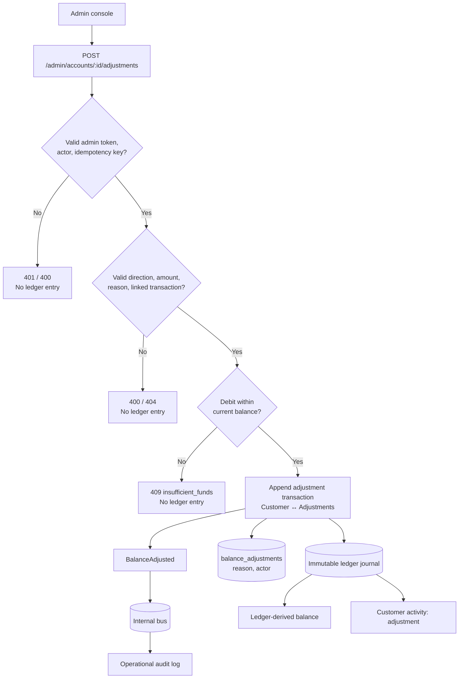

# Admin Balance Adjustments

Status: backend implemented and all acceptance scenarios pass; the admin UI form is pending

Acceptance tests:
[`BalanceAdjustmentAcceptanceSpec`](../src/test/scala/com/example/acceptance/BalanceAdjustmentAcceptanceSpec.scala)

## Problem

Sometimes an operator records the wrong amount, for example a deposit keyed as
100.00 instead of 150.00. Completed ledger transactions are immutable, and the
only correction today is `BillPaymentReversal`, which the bill-payment process
uses on its own. Admins have no audited way to fix a customer's balance.

## Approach

An admin posts an **adjustment**: a new ledger transaction for the
*difference*, optionally linked to the transaction it corrects. Nothing is
edited or deleted, and the original stays `posted` in the customer's history.

The counter entry goes to a new internal `Adjustments` ledger account, so every
adjustment balances:

| Direction | Customer entry | Counter entry       | Balance effect |
|-----------|----------------|---------------------|----------------|
| `credit`  | Credit         | Debit `Adjustments` | increase       |
| `debit`   | Debit          | Credit `Adjustments`| decrease       |

The net balance of `Adjustments` shows the total amount corrected across the
bank.



### Why not reverse and repost?

Reversing the wrong transaction and posting the right one also works, but it
doubles the history for every fix, does not work for transfers (two customer
entries), and would loosen the reversal rule that only bill payments use today.
Posting the difference keeps the history short, and the link to the original
explains it.

## API

```
POST /admin/accounts/:accountId/adjustments
Authorization: Bearer <ADMIN_TOKEN>
X-Admin-Actor: <admin identifier>
Idempotency-Key: <uuid>

{
  "direction": "credit" | "debit",
  "amount": 50.00,
  "reason": "Deposit keyed as 100 instead of 150",
  "adjustsTransactionId": "<uuid>"        // optional
}
```

`201 Created`:

```json
{
  "adjustmentId": "<uuid>",
  "accountId": "acc-1",
  "direction": "credit",
  "amount": 50.00,
  "currency": "THB",
  "reason": "Deposit keyed as 100 instead of 150",
  "actor": "ops-alice",
  "adjustsTransactionId": "<uuid>",
  "balanceAfter": 150.00,
  "occurredAt": "2026-10-29T03:00:00Z"
}
```

`GET /admin/accounts/:accountId/adjustments` returns the account's adjustments
oldest first, in the same shape. It needs the same `Authorization` header.

The customer and admin activity lists show the adjustment as
`operation: "adjustment"`, with `originalTransactionId` set to the linked
transaction.

### Errors

| Status | `error`                                  | When |
|--------|------------------------------------------|------|
| 400    | `invalid_adjustment_direction`           | Direction is not `credit` or `debit` |
| 400    | `invalid_adjustment_amount`              | Amount ≤ 0 or more than two decimals |
| 400    | `invalid_adjustment_reason`              | Reason missing, blank, or longer than 500 characters |
| 400    | `invalid_request`                        | Body is not JSON, or `adjustsTransactionId` is not a UUID |
| 400    | `missing_admin_actor`                    | `X-Admin-Actor` missing |
| 400    | `invalid_idempotency_key`                | `Idempotency-Key` missing or not a UUID |
| 400    | `adjusted_transaction_account_mismatch`  | Linked transaction has no entry for this account |
| 401    | `unauthorized`                           | Token missing or wrong, or no `ADMIN_TOKEN` configured |
| 404    | `account_not_found`                      | Account does not exist |
| 404    | `adjusted_transaction_not_found`         | Linked transaction does not exist |
| 409    | `insufficient_funds`                     | Debit is larger than the current balance |
| 409    | `duplicate_ledger_transaction`           | `Idempotency-Key` already used |

## Decisions

- **No negative balances.** A debit adjustment goes through the same funds check
  as a withdrawal. If money was already spent, recovering it is handled outside
  the system.
- **Single admin, no approval step.** Any authenticated admin can post. A
  maker-checker flow can be added later as a pending state.
- **Shared token auth.** `ADMIN_TOKEN` guards the adjustment endpoints only.
  If it is not set, adjustments are disabled. The existing read-only admin
  endpoints stay open so the current admin UI keeps working.
- **The idempotency key is the transaction id.** A replayed request hits the
  ledger's duplicate check and returns 409 instead of posting twice.
- **One transaction can be adjusted more than once.** The link is a plain
  column, not unique like `reverses_transaction_id`.
- **Insufficient funds is 409**, matching the customer API.

## Acceptance Criteria

Each item maps to a scenario in `BalanceAdjustmentAcceptanceSpec`.

Admin corrects a balance after a calculation mistake:

1. A credit adjustment tops up an under-credited deposit. The customer sees an
   `adjustment` activity linked to the deposit, and the deposit itself is
   unchanged.
2. A debit adjustment claws back an over-credited deposit.
3. An adjustment without a linked transaction is allowed.
4. The same transaction can be corrected more than once.
5. The admin console lists adjustments with their reason and actor, and the
   account detail shows the adjusted balance.

Adjustments never break ledger rules:

6. A debit larger than the balance is rejected and nothing is posted.
7. A replayed idempotency key does not post twice.
8. A linked transaction must exist.
9. A linked transaction must belong to the adjusted account.
10. An unknown account cannot be adjusted.
11. Invalid amount, direction, reason, or body is rejected without moving money.

Only authenticated admins can adjust balances:

12. A missing or wrong admin token is rejected.
13. The acting admin and a valid idempotency key are required.
14. Adjustments are disabled when no admin token is configured.

## Implementation Outline

1. Domain: `BankingOperation.Adjustment`, `LedgerAccount.Adjustments`,
   adjustment value types and errors, and `adjustsTransactionId` on
   `LedgerTransaction`.
2. Ledger: `AccountOperations.adjust`, posted through the existing
   `post(...)` path, with the linked transaction checked inside the same DB
   transaction.
3. Persistence: `ledger_transactions.adjusts_transaction_id` and a
   `balance_adjustments (transaction_id, reason, actor)` table. The ledger
   repository writes both in one DB transaction, so the money and its memo
   can't be split apart.
4. Application: `AdjustmentService` publishes `BalanceAdjusted`, and
   `AuditLogService` records it.
5. HTTP: adjustment routes and token check in `AdminServlet`, and
   `ADMIN_TOKEN` wiring in `Server`.
6. Admin UI *(pending)*: an adjust form with a balance preview and
   confirmation, tested in `admin-ui/e2e/admin-adjustments.spec.ts`.
7. Customer and admin UIs: a "Balance adjustment" activity label *(done)*.
